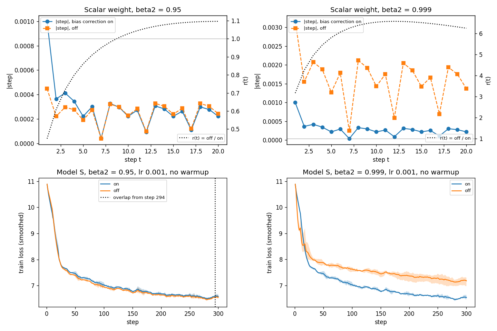
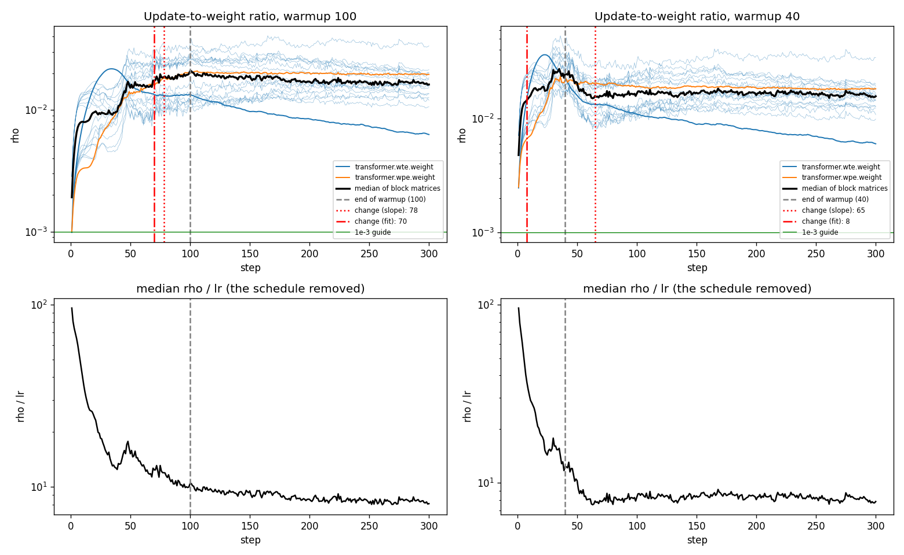
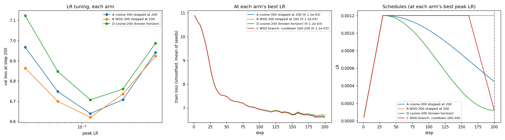
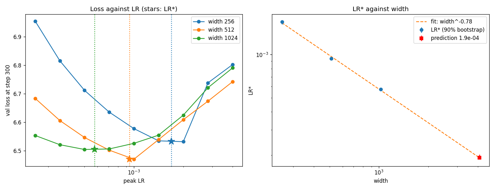

# Optimizer and Schedule Diagnostics (Session 11)

ERA V5 Session 11 assignment: Adam by hand, bias correction, update-to-weight ratio, cosine vs WSD, and a learning-rate sweep across widths. The task text is in [assignment.md](assignment.md).

The model is nanoGPT from [training-loop-diagnostics](https://github.com/jssunil/training-loop-diagnostics) (Session 10). The data is FineWeb web text, pre-tokenized with GPT-2 BPE (`kjj0/fineweb10B-gpt2` on Hugging Face): one 100 M-token training shard and one validation shard.

## Documents

| File | Content |
|---|---|
| [PLAN.md](PLAN.md) | Implementation plan: design options for each part, with advantages, disadvantages and the reason for each choice; fairness protocol; compute budget; tests. |
| [SESSION_11_EXPLAINER.md](SESSION_11_EXPLAINER.md) | Session 11 in depth: Adam, AdamW, bias correction, warmup, cosine and WSD, μP, newer optimizers, fair comparison; 33 checked papers with the key points of each (for the assignment) and the repos that implement them. |
| [SYSTEM_WALKTHROUGH.md](SYSTEM_WALKTHROUGH.md) | Three use cases through the full stack (one local training step, one V5 step on 768 GPUs, serving many users): OS, processes, CPU and GPU memory hierarchy, multiple GPUs and nodes, with diagrams. |

## How to run

```
python -m venv .venv && .venv\Scripts\activate
pip install -r requirements.txt
python scripts/get_fineweb.py      # about 400 MB into data/
python -m src.p1_adam_by_hand
python -m src.p2_bias_correction
python -m src.p3_update_ratio
python -m src.p4_cosine_vs_wsd
python -m src.p5_lr_sweep          # P5_FAST=1: x2 spacing and 1 seed
pytest                             # CPU only, no download needed
```

Smoke test of every code path first (a few minutes, the numbers mean nothing):

```
set QUICK=1   (PowerShell: $env:QUICK="1")
python -m src.p2_bias_correction
python -m src.p3_update_ratio
python -m src.p4_cosine_vs_wsd
python -m src.p5_lr_sweep
```

Each part writes its numbers to `results/<part>.json`, its plot to `results/<part>.png` and its log to `results/logs/<part>.log`.

## Results summary

Full run on 16 Oct 2026: RTX 5070 Ti, PyTorch 2.7.0 + CUDA 12.8, bf16, GPU duty limit 0.6. Total time 40 min (part 2: 3.4 min, part 3: 1.6 min, part 4: 8.5 min, part 5: 26 min). All models: 4 layers, context 512, batch 16, FineWeb GPT-2 tokens. Validation loss uses the same 40 validation batches for every run.

| Part | Question | Answer |
|---|---|---|
| 1 | Does the hand calculation equal `torch.optim.Adam`? | Yes. Difference ≤ 2.2e-16 in float64 and ≤ 5.3e-7 (relative) in float32, on the for-loop, foreach and fused paths. |
| 2 | When does bias correction stop mattering? | β2 = 0.95: the step ratio is within 1% from step 76; the loss difference is small. β2 = 0.999: the ratio needs 3,925 steps; without correction the loss is 0.64 higher at step 300. |
| 3 | When does warmup stop changing the update ratio? | Warmup 100: at about step 70–78. Warmup 40: at about step 65. After that, ρ ≈ 1.7e-2 for the block matrices. |
| 4 | Cosine or WSD, both stopped at step 200? | WSD: 6.620 against 6.639 (seed ranges do not overlap). Keep the WSD checkpoint. |
| 5 | LR for width 4096? | 1.9e-4 (fit LR* ∝ width^−0.78). Confidence: low to moderate. |

## Part 1: Adam by hand

One weight θ0 = 1, lr 0.1, β = (0.9, 0.999), ε = 1e-8, five gradients with sign changes and a 200× range of size. Script: `src/p1_adam_by_hand.py`.

| t | g | m | v | m̂ | v̂ | step | θ |
|---|---|---|---|---|---|---|---|
| 1 | 0.5 | 0.05000000 | 0.00025000 | 0.50000000 | 0.25000000 | −0.10000000 | 0.90000000 |
| 2 | −1.0 | −0.05500000 | 0.00124975 | −0.28947368 | 0.62518759 | 0.03661035 | 0.93661035 |
| 3 | 2.0 | 0.15050000 | 0.00524850 | 0.55535055 | 1.75125075 | −0.04196556 | 0.89464479 |
| 4 | 0.01 | 0.13645000 | 0.00524335 | 0.39677232 | 1.31280583 | −0.03462909 | 0.86001570 |
| 5 | −0.3 | 0.09280500 | 0.00532811 | 0.22662450 | 1.06775506 | −0.02193164 | 0.83808406 |

| PyTorch path | float64 (largest absolute difference) | float32 (largest relative difference) |
|---|---|---|
| for-loop (CPU) | 1.1e-16 | 5.3e-7 |
| foreach (CUDA) | 5.6e-17 | 5.3e-7 |
| fused (CUDA) | 2.2e-16 | 5.3e-7 |

Observations:
- Step 1 always moves θ by exactly lr (0.1). At t = 1, m̂ = g and v̂ = g², so m̂/√v̂ = sign(g).
- At t = 2 the gradient changes sign, but m̂ is only −0.29. The momentum from step 1 makes the step small (0.037).
- At t = 4 the gradient is 0.01, but the step is still −0.035. Adam moves on the history in m and v, not on the current gradient.
- Weight decay 0.1 for 5 steps: L2 (`Adam`) gives θ = 0.8063, decoupled (`AdamW`) gives θ = 0.7931. They differ because L2 goes through m and v and is divided by √v̂. Decoupled decay is not.

## Part 2: Bias correction



r(t) = (uncorrected step) / (corrected step) = (1 − β1^t) / √(1 − β2^t). The measured ratio equals the formula (largest difference 3.1e-8 for β2 = 0.95, 1.9e-6 for β2 = 0.999).

| β2 | r(1) | r(20) | Largest r | r within 1% of 1 from step |
|---|---|---|---|---|
| 0.95 | 0.447 | 1.097 | 1.10 | 76 |
| 0.999 | 3.162 | 6.241 | 6.57 (t = 12) | 3,925 |

Model S, lr 1e-3, no warmup, 300 steps, 3 seeds (smoothed training loss at step 300):

| β2 | Correction on | Correction off | Result |
|---|---|---|---|
| 0.95 | 6.584 | 6.549 | Small difference. The seed ranges overlap from step 294. |
| 0.999 | 6.531 | 7.173 | Large difference. The ranges do not overlap at step 300. |

Answer:
- **The answer depends on β2.** With β2 = 0.95 the correction stops mattering by step 76 (ratio) and its effect on the loss is small. With β2 = 0.999 it matters for about 4,000 steps.
- With β2 = 0.95, "off" makes the first step smaller (0.45×) and steps 10–60 slightly larger (up to 1.10×). At lr 1e-3, which is below the best LR for this model (about 1.7e-3, part 5), slightly larger steps help a little. That is why "off" is 0.035 lower.
- With β2 = 0.999, "off" makes steps 2 to 6.6 times larger for the whole run (r(300) = 1.96). It acts as an LR far above the best value, and the loss stays 0.64 higher.
- The 20-step window of the task is not enough to see "stop mattering" for β2 = 0.999: r(20) = 6.2 is close to its peak.

## Part 3: Update-to-weight ratio during warmup



ρ = ‖W_after − W_before‖ / ‖W_before‖ for each weight tensor, each step. Constant lr 2e-3 after a linear warmup, 300 steps, 3 seeds. "Block matrices" are the attention and MLP weights; the embeddings are shown apart.

| Warmup | ρ stops changing (rolling slope) | (two-line fit) | Median block ρ after warmup | wte ρ | wpe ρ | Clip events |
|---|---|---|---|---|---|---|
| 100 steps | 78 (per seed 82, 22, 64) | 70 | 1.71e-2 | 8.1e-3 | 2.0e-2 | 157 |
| 40 steps | 65 (per seed 49, 56, 66) | 8 | 1.66e-2 | 8.5e-3 | 1.9e-2 | 105 |

Answer:
- **Warmup 100:** ρ rises with the LR. It stops changing at about step 70–78, before warmup ends: ρ levels off before the LR stops rising.
- **Warmup 40:** ρ overshoots near the end of warmup and settles at about step 65, which is 25 steps after warmup ends. The two-line fit (step 8) is wrong here: it finds the first fast rise. Use the rolling-slope value.
- **ρ / lr** (lower plots) removes the schedule. It falls fast at the start and becomes flat at about step 60 (warmup 40) and about step 150 (warmup 100). After that, ρ follows the LR.
- **Level:** the block ρ is about 1.7e-2. This is 17 times the 1e-3 guide from Karpathy. The run is short and lr 2e-3 is above the best LR for 300 steps. Thus a high ρ is expected here; it is not a fault.
- **Embeddings:** the token embedding (wte) has a lower ρ, and it keeps falling. It is tied to the output layer, so its gradient is dense. A probable cause: most rows belong to rare tokens, whose gradients are small and change sign often, so |m̂|/√v̂ is well below 1 for them. This run does not test that cause. The position embedding (wpe) is like the blocks.
- Gradient clipping at 1.0 acted on 157 and 105 steps (of 300 × 3 seeds).

## Part 4: Cosine vs WSD, stopped at step 200



Model S, warmup 30, both schedules planned for 300 steps and stopped at step 200. Each arm is tuned over 5 peak LRs (3e-4 to 4.8e-3, ×2 spacing) with 3 seeds. Validation loss at step 200:

| Peak LR | A cosine-300 | B WSD-300 | D cosine-200 |
|---|---|---|---|
| 3.0e-4 | 6.967 | 6.864 | 7.124 |
| 6.0e-4 | 6.748 | 6.699 | 6.847 |
| **1.2e-3** | **6.639** | **6.620** | **6.707** |
| 2.4e-3 | 6.707 | 6.736 | 6.760 |
| 4.8e-3 | 6.941 | 6.924 | 6.988 |

Each arm at its best LR (1.2e-3 for all):

| Arm | Schedule | Mean | Seed range |
|---|---|---|---|
| C | WSD planned for 200 (cooldown 160–200), at B's LR | **6.6175** | 6.6144–6.6202 |
| B | WSD planned for 300, stopped at 200 | 6.6200 | 6.6156–6.6227 |
| A | Cosine planned for 300, stopped at 200 | 6.6387 | 6.6369–6.6422 |
| D | Cosine planned for 200 (known horizon) | 6.7067 | 6.7051–6.7087 |

Answer:
- **WSD (B) is better than cosine (A) at step 200** by 0.019. The seed ranges do not overlap. B is lower at 4 of the 5 LRs.
- **Which model to keep: the WSD checkpoint (B).** It has the lower loss now. It is still at peak LR, so training can continue from it with no change. A cooldown of 40 steps (arm C) gives a lower loss for the same compute.
- **Cosine planned for 200 (D) is the worst arm, at every LR.** At step 200 it is at its minimum LR. After only 1.6 M tokens the model is far from converged (loss 6.6), so a high LR still gives the most progress. An early decay costs more than it gives. This agrees with the river-valley view (Wen et al.): the decay gives a fast gain only at the end, and a long high-LR phase sets how far the model gets.
- Arm C equals arm B up to step 160 (same seed, data and LR). Thus C is a cooldown branch of B. Its gain over B is small (0.0025) because 40 steps of decay at this stage give little.

## Part 5: Learning-rate sweep at widths 256, 512 and 1024



4 layers, head size 64, 300 steps (2.5 M tokens), warmup 30 + cosine to 0.1 × peak, AdamW λ = 0.1. 9 LRs from 2.5e-4 to 4e-3 (×√2 spacing), 2 seeds. LR* is the vertex of a parabola in log(LR) through the lowest point and its two neighbours. The interval is a 90% bootstrap over seeds (500 samples).

| Width | Weights | LR* | 90% interval | Lowest val loss |
|---|---|---|---|---|
| 256 | 16 M | 1.69e-3 | 1.6e-3 to 1.7e-3 | 6.532 |
| 512 | 38 M | 9.38e-4 | 9.2e-4 to 9.5e-4 | 6.471 |
| 1024 | 102 M | 5.75e-4 | 5.7e-4 to 5.8e-4 | 6.505 |

Fit: **LR* ∝ width^−0.78** (90% bootstrap −0.79 to −0.75).

**Prediction for width 4096: LR ≈ 1.9e-4** (bootstrap 1.9e-4 to 2.0e-4).

**Confidence: low to moderate.** The bootstrap interval is narrow, but it covers seed noise only. These effects are not in it:
- 4096 is 4 times outside the measured widths. Three points fix a line, but they do not test it.
- A real width-4096 model trains on far more tokens. LR* falls with longer training, so the true value is probably lower.
- Batch size, depth and the token count are fixed here. LR* depends on each of them.
- At small width the embedding is a large part of the weights (the 50,304 × d token table). Its best LR changes with width differently from the block matrices.
- Two seeds give a narrow interval that is too optimistic.
- The exponent −0.78 is near the −1 that standard parametrization predicts for Adam on hidden matrices. It is not equal to it. μP removes this dependence, which is the production fix.

Other observations:
- Width 1024 is not better than width 512 at 300 steps (6.505 against 6.471). A larger model needs more tokens to show its advantage.
- The width-256 curve is flat from 1.4e-3 to 2e-3, then rises sharply at 2.8e-3. The loss rises faster above LR* than below it, so choose an LR slightly below the estimate.

## Fair comparison: how both sides were tuned

- Each arm (A, B, D in part 4; each width in part 5) gets the same LR grid and the same seeds.
- Each comparison uses validation loss on the same 40 fixed batches, not training loss.
- The training data order depends only on the seed, so arms with the same seed see the same batches.
- If the best LR is at an edge of the grid, `train.lr_sweep` adds one more LR past that edge (up to two times). In the full run, no best value stayed at an edge.
- Each arm is compared at its own best LR, with the min–max range over seeds.

## Limits

- **Short runs.** 200–300 steps (1.6–2.5 M tokens). The loss is still about 6.5, so the conclusions apply to the early part of training. The ranking of the schedules can change for long runs.
- **Few seeds.** 3 seeds (parts 2–4) and 2 seeds (part 5). The ranges show seed noise, but they are not confidence intervals.
- **Coarse grid in part 4.** ×2 spacing. All arms chose 1.2e-3. A finer grid can change the gaps a little.
- **One shard.** 100 M training tokens; each run uses at most 2.5 M of them.
- **bf16 autocast** on the GPU. Part 1 uses float64 and float32 only.

## References

- Kingma and Ba, Adam: A Method for Stochastic Optimization, arXiv:1412.6980
- Loshchilov and Hutter, Decoupled Weight Decay Regularization (AdamW), arXiv:1711.05101
- Hu et al., MiniCPM (WSD schedule), arXiv:2404.06395
- Yang et al., Tensor Programs V (μP), arXiv:2203.03466
- Wen et al., Understanding Warmup-Stable-Decay Learning Rates: A River Valley Loss Landscape Perspective, arXiv:2410.05192
