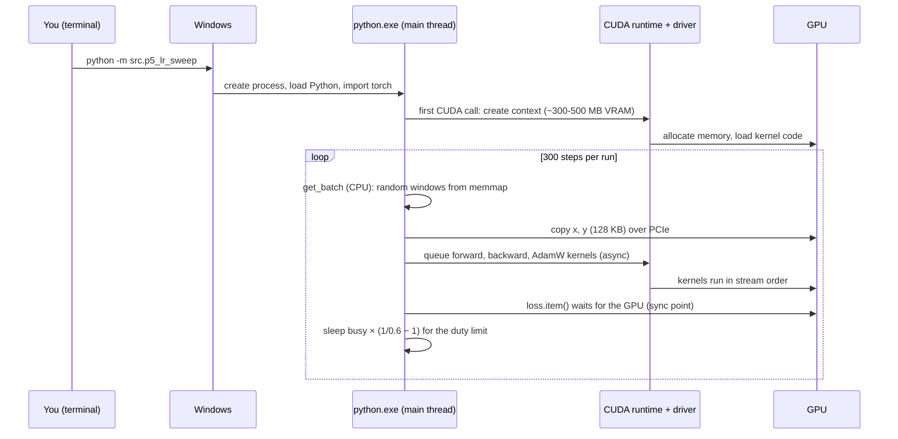
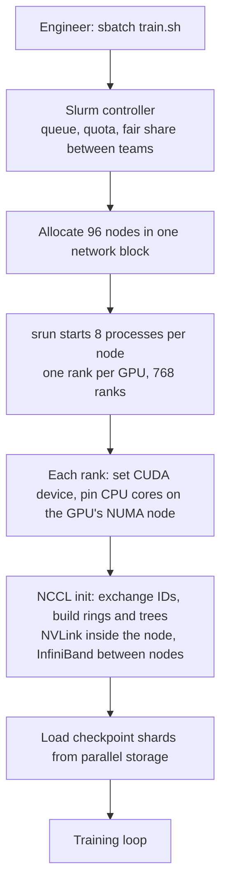
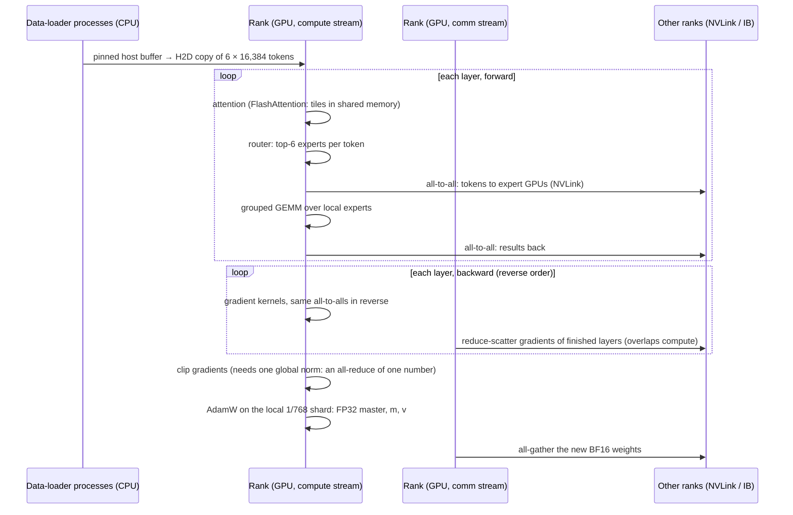
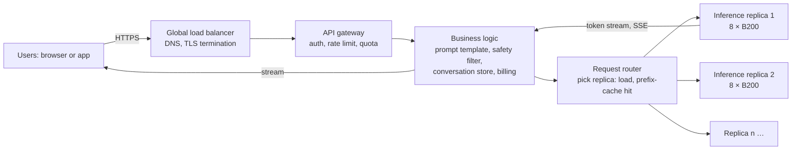
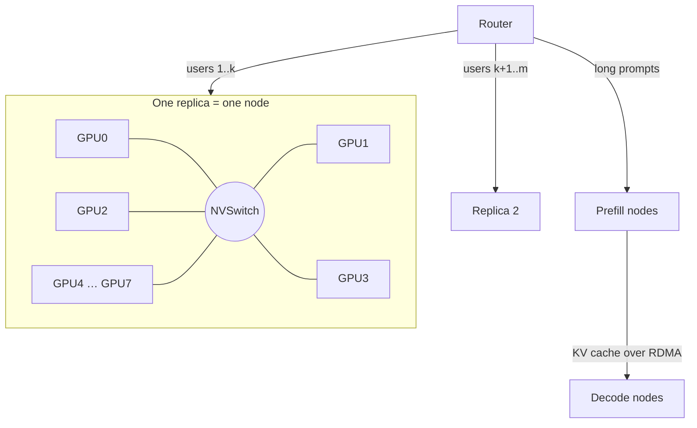

# System Walkthrough: Three Use Cases Through the Full Stack

This document follows three use cases from the requirement down to the registers, and back up. Each use case passes through the same layers: requirement, request, network, server, business logic, OS, processes and threads, CPU and its caches, memory, GPU and its caches, hardware, multiple GPUs, multiple nodes, cloud, and multiple users.

| # | Use case | Scale |
|---|---|---|
| 1 | One training step of this project (Part 5, width 1024) | 1 process, 1 RTX 5070 Ti, 1 user |
| 2 | One AdamW training step of the V5 capstone model | 768 processes, 768 B200 GPUs, 96 nodes |
| 3 | Many users chat with the trained V5 model | Thousands of users, a fleet of GPU servers |

**Labels for numbers.** [measured] = measured on this machine or in this project. [spec] = a vendor or course figure. [derived] = calculated here from the other numbers. [assumption] = a value chosen to make the example concrete; change it to the real value when you know it.

**Words.**

| Word | Meaning |
|---|---|
| Kernel | One function that runs on the GPU, launched by the CPU |
| SM | Streaming multiprocessor: one GPU core group with its own registers, shared memory and L1 cache |
| Warp | 32 GPU threads that run the same instruction together |
| HBM / GDDR | The main GPU memory (B200: HBM3e; RTX 5070 Ti: GDDR7) |
| Arithmetic intensity (AI) | FLOPs per byte moved from main memory. Above the ridge point a kernel is compute-bound; below it, memory-bound |
| Ridge point | Peak FLOP/s ÷ memory bandwidth |
| Rank | One training process, normally one per GPU |
| NCCL | NVIDIA's library for collective communication between GPUs |
| KV cache | The keys and values of earlier tokens, kept so that each new token does not recompute them |
| Prefill / decode | Prefill processes the whole prompt in one pass; decode makes one new token per pass |

---

## 0. The hardware in this project

### 0.1 The local machine [measured unless marked]

| Part | Value |
|---|---|
| CPU | Intel Core Ultra 7 265K: 20 cores (8 performance + 12 efficiency), no hyper-threading |
| CPU caches | L1 per core; L2 per core or per 4-core efficiency cluster; L3 about 30 MB shared [spec] |
| Host memory | 64 GB DDR5 |
| CPU–GPU link | PCIe 5.0 x16, about 64 GB/s each way [spec]. nvidia-smi shows "gen 1" at idle: that is power saving, and the link speeds up under load |
| GPU | RTX 5070 Ti (Blackwell, compute capability 12.0), 70 SMs, max clock 3,090 MHz |
| Registers | 65,536 × 32-bit per SM = 256 KB per SM, 17.5 MB in total |
| Shared memory | 100 KB per SM available to kernels (L1 and shared memory share one SRAM) |
| L2 cache | 48 MB, shared by all SMs |
| GPU memory | 16 GB GDDR7, 896 GB/s [spec] |
| Compute | 96.9 TFLOP/s on one large BF16 matmul [measured in P10]. Ridge point: 96.9e12 / 896e9 ≈ **108 FLOP/byte** [derived] |
| OS | Windows 11; GPU driver in WDDM mode, so Windows schedules the GPU and shares it with the desktop |

### 0.2 The memory hierarchy, fastest to slowest

```text
                 size (5070 Ti)       bandwidth / latency (approx.)
 ┌──────────────┐
 │  Registers   │  256 KB per SM       ~1 cycle; feeds the tensor cores
 ├──────────────┤
 │ Shared / L1  │  ~100-128 KB per SM  ~20-30 cycles; tiles of A and B live here
 ├──────────────┤
 │   L2 cache   │  48 MB (all SMs)     ~200-300 cycles
 ├──────────────┤
 │ GDDR7 (VRAM) │  16 GB               896 GB/s; ~500+ cycles
 ╞══════════════╡  ← PCIe 5.0 x16, ~64 GB/s each way
 │ Host DDR5    │  64 GB               CPU side; OS page cache lives here
 ├──────────────┤
 │ NVMe SSD     │  TB                  GB/s; the token file lives here
 └──────────────┘
 CPU side has its own ladder: registers → L1 → L2 → L3 (~30 MB) → DDR5.
```

The rule that follows: every byte that moves down one level costs about 10× more time. A fast kernel loads a tile into a faster level once and reuses it many times.

---

## 1. Use case 1: one training step of Part 5 on the local GPU

### 1.1 Requirement

Run the Part 5 learning-rate sweep: 3 widths × 9 learning rates × 2 seeds, 300 steps each. Each step trains a 4-layer GPT (width 1024) on 16 × 512 = 8,192 tokens. Constraints: one consumer GPU shared with the desktop, at most 60% GPU duty and at most 60% of GPU memory (`GPU_DUTY`, `GPU_MEM_FRACTION` in `src/device.py`). The whole Part 5 took 26 minutes [measured].

**Model size [derived]:** blocks 12 × 1024² × 4 = 50.3 M; token embedding 50,304 × 1024 = 51.5 M (tied to the output layer); total about 102 M weights.

### 1.2 The request: from a command to a process



There is no network and no server in this use case. The "business logic" is the experiment: the learning-rate grid, the seeds, and the rule that every arm sees the same data order and the same validation batches.

### 1.3 OS, process and threads

- **One process, one main thread.** Python runs the training loop on one thread. The GIL does not matter here, because the heavy work is on the GPU.
- **PyTorch adds helper threads:** intra-op CPU threads (for CPU tensor work), and CUDA driver threads. The data loading is done inline in the main thread, not in DataLoader worker processes. That is acceptable because one batch is tiny (below).
- **Other processes share the GPU.** About 40 desktop processes (Explorer, Chrome, Slack, NVIDIA Overlay …) held 3.3 GB of VRAM [measured]. Under WDDM, Windows time-slices the GPU between them. WDDM also has a timeout (TDR, about 2 s by default): a single kernel that runs longer is killed. Training kernels are milliseconds, so this is safe.
- **Memory cap.** `torch.cuda.set_per_process_memory_fraction(0.6)` stops this process at 60% of 16 GB, so the desktop keeps working.

### 1.4 CPU, CPU caches and host memory: making one batch

`get_batch` (`src/data.py`) does this for each step:

1. `np.memmap` maps the 100 M-token file (200 MB of `uint16`) into the address space. Nothing is read yet.
2. It picks 16 random start positions and slices 513 tokens at each. The first touch of a page causes a **page fault**: the OS reads the 4 KB page from the NVMe SSD into the **OS page cache** in DDR5. Later touches hit the page cache. The whole file fits in 64 GB, so after some steps no disk reads remain.
3. `np.stack(...).astype(np.int64)` copies 16 × 513 × 2 B = 16 KB and widens it to 64 KB. This work is in the CPU **L1/L2 caches**: 16 KB is smaller than one core's L2.
4. `.to(device)` copies x and y (2 × 64 KB) to the GPU. The tensor is in pageable memory, so the driver first copies it to a pinned staging buffer, then DMA sends it over PCIe. At 64 GB/s, 128 KB takes about 2 µs plus a fixed latency of some µs.

Conclusion: the input path costs microseconds, and the step costs about 100+ ms. Here, optimizing data loading would give nothing. (In use case 2 this is different.)

### 1.5 GPU: the forward pass through the memory hierarchy

The CPU only **queues** kernels. Each PyTorch operation goes: Python → dispatcher → CUDA kernel launch (some µs of CPU time) → a command buffer → the GPU. The CPU runs ahead of the GPU until a sync point.

Take one large matmul: the MLP up-projection `c_fc`: (8,192 × 1,024) × (1,024 × 4,096).

| Quantity | Value [derived] |
|---|---|
| FLOPs | 2 × 8192 × 1024 × 4096 = 68.7 GFLOP |
| Minimum bytes (A, B, C in BF16) | 92 MB |
| Arithmetic intensity | 745 FLOP/byte, far above the ridge (108) → **compute-bound** |
| Time at 96.9 TFLOP/s | about 0.71 ms |

How the kernel uses the hierarchy (a typical tiled GEMM; the cuBLAS choice can differ):

```text
 GDDR7: A (16 MB), B (8 MB)                        C (64 MB)
    │  each thread block loads a 128×32 tile of A      ▲
    │  and a 32×128 tile of B (8 KB each, BF16)        │ write the 128×128
    ▼                                                  │ result tile once
 L2 (48 MB): tiles that neighbour blocks also need are often hits here
    ▼
 Shared memory of one SM: the two tiles, double-buffered
    ▼
 Registers: each thread holds part of the 128×128 FP32 accumulator
    ▼
 Tensor cores: multiply BF16 fragments, add into FP32 registers
 Loop over K (1024 / 32 = 32 times), then write C.
```

Each tile of A that is loaded once from GDDR7 is used for 128 output columns. That reuse is the only reason the kernel is compute-bound. 70 SMs work on different output tiles at the same time: 8192/128 × 4096/128 = 2,048 tiles, about 29 waves of 70.

**The memory-bound parts of the forward pass:** LayerNorm, GELU, residual adds and softmax read and write the full activation tensor for a few FLOPs each. They are below the ridge. Fusion (for example `torch.compile`, or attention with `scaled_dot_product_attention`, which keeps the attention scores in shared memory) removes these round trips to GDDR7.

**The logits are the largest single tensor.** 8,192 tokens × 50,304 vocabulary × 2 B = 824 MB in BF16, and 1.65 GB if the loss upcasts to FP32 [derived]. That is why the chunked cross-entropy (W03) matters at a large vocabulary.

### 1.6 Backward and the AdamW step

- **Backward** runs about 2× the forward FLOPs. It reads the saved activations. Total per step: 6 × 102 M × 8,192 ≈ **5.0 TFLOP** [derived]. At about 40 TFLOP/s (the P10 achieved rate) that is about 125 ms.
- **AdamW (fused)** is memory-bound. For each weight it reads θ, g, m, v (FP32, 16 B) and writes θ, m, v (12 B): 28 B per weight, for about 15 FLOPs.

| AdamW step | Value [derived] |
|---|---|
| Bytes moved | 102 M × 28 B = 2.87 GB |
| Time at 896 GB/s | about 3.2 ms (about 2–3% of the step) |
| Arithmetic intensity | about 0.5 FLOP/byte: 200× below the ridge |

Why the three PyTorch paths of Part 1 differ: the **for-loop** path launches several kernels per tensor (about 50 tensors here), the **foreach** path batches tensors into few launches, and the **fused** path does everything in one pass over memory. They compute the same values (Part 1 checked this); they differ in launch count and memory traffic.

### 1.7 Memory budget on the GPU [derived; about 8 GB measured]

| Item | Size |
|---|---|
| CUDA context and kernels | 0.3–0.5 GB |
| Weights, gradients, m, v (FP32, 16 B per weight) | 1.64 GB |
| Saved activations (≈ 34 × T × B × d bytes per layer × 4 layers) | about 1.1 GB |
| Logits and loss buffers | 0.8–2.5 GB |
| PyTorch caching allocator (freed blocks it keeps for reuse) | the rest |

### 1.8 Sync points: where the CPU waits

`loss.item()` and `gnorm.item()` in `src/train.py` copy one number to the CPU. The CPU must wait for every queued kernel to finish. During that wait the GPU queue empties, so the next step starts with an idle GPU for some µs. In Part 3, the per-tensor ρ logging adds more of these. At this model size the cost is small. On a large model, log less often or collect values on the GPU and copy them once every k steps.

### 1.9 Time budget of one step (width 1024)

| Phase | Time | Bound by |
|---|---|---|
| Make batch on the CPU, copy over PCIe | µs | latency |
| Forward + backward | about 100–150 ms | tensor cores (matmuls), GDDR7 (element-wise ops) |
| AdamW (fused) | about 3 ms | GDDR7 bandwidth |
| `.item()` syncs | µs each | CPU–GPU round trip |
| Duty-limit sleep | busy × 0.67 | our own limit |

---

## 2. Use case 2: one AdamW step of the V5 model on 768 GPUs

### 2.1 Requirement [spec, from the course context]

| Item | Value |
|---|---|
| Model | 78.1 B weights, 3.46 B active per token (MoE: 384 routed experts of width 512, top-6, plus 1 shared; hidden 2,560; vocabulary 128,000; BF16) |
| Cluster | 768 B200 GPUs = 96 nodes × 8 |
| Step | 4,608 sequences × 16,384 tokens = 75.5 M tokens, about 6 s |
| Total | 20 T tokens, 21 days |
| Training state | 16 bytes per weight = 1,164 GiB |

**Derived:**
- Each GPU processes 75.5 M / 768 ≈ 98,300 tokens per step: 6 sequences of 16,384.
- FLOPs per step ≈ 6 × 3.46 B × 75.5 M = 1.57 × 10¹⁸. Per GPU: 1.57e18 / 768 / 6 s ≈ **340 TFLOP/s achieved**. B200 dense BF16 is about 2.2 PFLOP/s [spec], so MFU ≈ 15%. MoE routing and communication explain much of the gap.
- The 16 bytes: BF16 weight (2) + BF16 gradient (2) + FP32 master weight (4) + FP32 m (4) + FP32 v (4).

### 2.2 Request: from a job to 768 processes



**Multiple users** here are the teams that share the cluster. The scheduler (Slurm) holds the "business logic" of the cluster: queues, priorities, quotas and pre-emption. The training job's own business logic is the run plan: data mixture, schedule (WSD), checkpoint interval, alert rules and the stop rule.

### 2.3 One node

```text
 ┌──────────────────────────── one node (HGX B200) ─────────────────────────────┐
 │  CPU socket 0 (NUMA 0)                     CPU socket 1 (NUMA 1)             │
 │  DDR5, data-loader processes               DDR5, data-loader processes       │
 │     │ PCIe switch                               │ PCIe switch                │
 │  GPU0 GPU1 GPU2 GPU3                       GPU4 GPU5 GPU6 GPU7               │
 │  NIC0 NIC1 NIC2 NIC3                       NIC4 NIC5 NIC6 NIC7  ← 1 NIC/GPU  │
 │    └────────────── NVSwitch: every GPU to every GPU ──────────┘              │
 │                    (NVLink 5, about 1.8 TB/s per GPU [spec])                 │
 └──────────────────────────────────────────────────────────────────────────────┘
        │ each NIC: about 400 Gb/s (50 GB/s) to the InfiniBand fabric [spec]
        ▼
   leaf switches → spine switches → the other 95 nodes
```

Two facts drive the parallel layout:
1. NVLink inside the node is more than 30× faster than one NIC between nodes. Put the heaviest communication (MoE all-to-all, tensor parallel) inside the node.
2. **GPUDirect RDMA:** the NIC reads and writes GPU memory directly. The CPU and host memory are not on the data path.

### 2.4 Parallel layout [assumption: one possible layout]

| Dimension | Size | What is split | Communication |
|---|---|---|---|
| Expert parallel (EP) | 8 (inside the node) | Each GPU holds 384/8 = 48 routed experts per layer | All-to-all: send each token to the GPUs of its 6 experts, and back |
| Data parallel (DP) | 96 (across nodes) | Each node group gets different sequences | Reduce-scatter of gradients, all-gather of weights |
| Optimizer sharding (ZeRO-1) | over DP | FP32 master, m, v | Part of the DP collectives |

If the 16 B per weight is fully sharded over the 768 GPUs, it is only 1,164 / 768 ≈ **1.5 GiB per GPU** [derived]. Thus at this scale the optimizer state is small per GPU. Activations for 98 K tokens and the communication buffers take most of the 180+ GB of HBM.

### 2.5 One step, layer by layer



**Overlap.** The backward pass of layer k runs on the compute stream while the gradients of layer k+1 move on the communication stream. NCCL uses SMs and its own CPU proxy threads to drive the transfer. Without overlap, the step time would be compute plus communication; with overlap, it approaches the larger of the two.

**Ring all-reduce cost.** Each GPU sends about 2 × (N−1)/N × S bytes for a buffer of S bytes. The cost per GPU hardly grows with N, but the latency does. That is why large clusters use trees and hierarchical (node-first) collectives.

**The AdamW step at this scale.** The optimizer math is the same as in Part 1. Each GPU updates about 78.1 B / 768 ≈ 100 M weights, about as many as the whole local model in use case 1, so it takes some ms on HBM3e (about 8 TB/s [spec]). The Part 1 reference test is how you prove that a sharded, fused or 8-bit optimizer still matches the equations.

### 2.6 OS, processes and threads on one node

| Item | Detail |
|---|---|
| Processes | 8 training ranks; each has some data-loader worker processes |
| Threads per rank | Python main thread; CUDA driver threads; NCCL proxy threads; PyTorch intra-op threads |
| CUDA streams | Compute stream, communication stream(s), copy stream |
| NUMA | Pin each rank and its loaders to the CPU socket nearest its GPU and NIC. A wrong pin sends traffic across the socket link |
| Host memory | Pinned (page-locked) buffers for H2D copies; huge pages for less TLB pressure |
| OS | Linux, drivers in persistence mode, ECC on; cgroups limit each job |

### 2.7 Failures, checkpoints and the cloud

- **Mean time between failures.** For this cluster, the course plan uses MTBF ≈ 12.9 h. Llama 3 saw 47% of interruptions from GPU or HBM faults.
- **Checkpoint interval (Young):** √(2 × save time × MTBF). With a save time of 60 s [assumption], √(2 × 60 × 12.9 × 3600) s ≈ **39 min** [derived].
- **Save path:** each rank writes its own shard (asynchronously: copy to host memory first, then write while training continues) to a parallel file system or object storage.
- **Cloud layer:** reserved capacity in one placement group (close network), a parallel file system for checkpoints, object storage for data shards, and health checks that remove a bad node and restart from the last checkpoint on spare nodes.
- **Alerts** come from the course dashboard: Xid 79/94/95 or ECC errors page a person; a NaN stops the run.

---

## 3. Use case 3: many users chat with the trained V5 model

### 3.1 Requirement [assumption: example targets]

| Item | Target |
|---|---|
| Concurrent conversations | 1,000+ per replica at peak |
| Time to first token (TTFT) | p50 < 1 s |
| Time per output token (TPOT) | p50 < 50 ms (20+ tokens/s for each user) |
| Context per conversation | up to 4,096 tokens |
| Availability | survive the loss of one GPU server |

### 3.2 The request path



**Network.** The client opens TLS over TCP (or QUIC). Output streams back as server-sent events, one small message per token or group of tokens. Long-lived connections need a load balancer that supports streaming and has long idle timeouts.

**Business logic** sits outside the GPU: authentication, per-user quotas, the chat template, safety filters on input and output, storage of the conversation, and billing by input and output tokens. These are CPU services that scale out with ordinary web servers.

### 3.3 Inside one inference replica

```text
 ┌──────────────────────── inference server (one node, 8 GPUs) ───────────────────────┐
 │ API process (async event loop, many connections on few threads)                    │
 │   └─ tokenizer (CPU, a thread pool): text → token IDs                              │
 │ Engine process                                                                     │
 │   └─ scheduler: continuous batching. Every step it adds new requests, removes       │
 │      finished ones, and decides prefill vs decode work and KV blocks                 │
 │ 8 GPU worker processes (one per GPU), split by EP and/or TP                        │
 │   ├─ weights: 78.1 B × 2 B = 156 GB in BF16, split over 8 GPUs                    │
 │   └─ KV cache: paged blocks (for example 16 tokens per block) in the free HBM      │
 │ Detokenizer: token IDs → text pieces → back to the API process                     │
 └────────────────────────────────────────────────────────────────────────────────────┘
```

**Processes and threads.** The API process handles thousands of slow network connections with an async event loop: one thread can wait on many sockets. The engine runs the batch loop. Each GPU has its own worker process. Separate processes keep the Python GIL away from the hot loop, and they let a crashed worker restart without killing the HTTP layer.

### 3.4 Memory: the KV cache decides capacity

KV bytes per token = 2 (K and V) × layers × KV heads × head size × 2 B.
With 48 layers, 8 KV heads and head size 128 [assumption: the real V5 attention shapes may differ]:

| Quantity | Value [derived] |
|---|---|
| KV per token | 2 × 48 × 8 × 128 × 2 B = 192 KiB |
| One 4,096-token conversation | 768 MiB |
| HBM of 8 GPUs (≈180 GB each) minus 156 GB weights | about 1.28 TB for KV and buffers |
| Tokens that fit | about 6.5 M |
| Full 4,096-token conversations that fit | about 1,600 |

**PagedAttention** stores the KV cache in fixed blocks, like OS virtual memory pages, so memory is not wasted on the unused tail of each conversation. **Prefix caching** shares the blocks of a common prefix (the system prompt) between users. That is a cache hit: no prefill compute and no extra memory for that part.

**Cache levels in serving:**

| Cache | Where | What it saves |
|---|---|---|
| KV cache | GPU HBM | Recomputing earlier tokens at each decode step |
| Prefix cache | GPU HBM (can spill to host DDR or SSD) | Prefill for shared prompts |
| GPU L2 / shared memory | Inside the attention and GEMM kernels | Re-reading tiles from HBM |
| CPU L1–L3 | Tokenizer, scheduler | Tokenizer vocabulary lookups, scheduler data |
| Conversation store, response cache | Business-logic tier (database, in-memory cache) | Reloading history; repeated identical requests |

### 3.5 Prefill and decode: two different bottlenecks

| Phase | Work for one request | Bound by |
|---|---|---|
| Prefill (2,048-token prompt) | 2 × 3.46 B × 2,048 ≈ 14 TFLOP [derived] | Tensor cores. Many tokens per weight read, so AI is high |
| Decode (1 token) | Read the weights of the experts in use and the KV of the conversation | HBM bandwidth. One token per weight read, so AI ≈ 1 |

**Why batching is the core idea of serving.** In decode, the weights are read once per step for the whole batch. One user alone needs only the 3.46 B active weights: 6.9 GB, a lower limit of about 0.1 ms on 8 GPUs at 8 TB/s each [derived]. At a large batch, the 6 experts of 256 tokens cover almost all 384 experts, so a step reads almost all 156 GB: a lower limit of about 2.4 ms [derived], shared by all 256 users. So a larger batch costs more per step but much less per user. The real step time is many times these limits because of the all-to-all, kernel launches and attention over the KV cache.

**Chunked prefill.** A long prompt in the same batch as decode work makes every user's next token late. The scheduler cuts a long prefill into chunks and mixes them with decode steps, so TPOT stays smooth.

### 3.6 Multiple users, GPUs and nodes



- **Multiple GPUs in one replica:** expert parallel (each GPU holds 48 experts) or tensor parallel. Communication stays on NVLink.
- **Multiple nodes:** add replicas behind the router (scale out). Large systems also split prefill and decode onto different nodes ("disaggregated serving") and send the KV cache between them over RDMA.
- **Multiple users and fairness:** per-user rate limits at the gateway, and a scheduler policy (first come, first served, with limits per user) so that one long request does not block others. Under overload, reject early (HTTP 429) rather than let all latencies grow.
- **Failure:** a health check sees a GPU error (Xid). The router drains that replica: no new requests. Active streams on it fail and the client retries on another replica. The conversation is safe in the business-logic store.

---

## 4. One table: each layer in the three use cases

| Layer | 1. Local training step | 2. V5 training step | 3. Serving many users |
|---|---|---|---|
| Requirement | 54 runs in 26 min, GPU shared with desktop | 75.5 M tokens / 6 s, 21 days | TTFT < 1 s, TPOT < 50 ms |
| Request | `python -m src.p5_lr_sweep` | `sbatch` → 768 ranks | HTTPS request with a prompt |
| Network | none | NVLink + InfiniBand, NCCL collectives | Internet, TLS, load balancer, SSE stream |
| Server | your PC | 96 GPU nodes | API servers + GPU replicas |
| Business logic | experiment grid, fairness rules | run plan, scheduler quotas | auth, quota, safety, billing |
| OS | Windows, WDDM time-slicing, page cache | Linux, NUMA pinning, pinned memory, cgroups | Linux, async I/O, process isolation |
| Processes / threads | 1 process, 1 main thread | 8 ranks per node + loaders + NCCL threads | API, engine, 8 GPU workers |
| CPU and caches | batch making in L1/L2 | data decode, NCCL proxies | tokenizer, scheduler, HTTP |
| Host memory | page cache for the token file | pinned buffers, async checkpoint staging | prefix-cache spill |
| GPU memory | 1.6 GB states + activations + logits | ~1.5 GiB state shard + activations | weights + paged KV cache |
| GPU caches | GEMM tiles in shared memory and L2 | same, plus FlashAttention tiles | same; KV reads dominate decode |
| Registers | GEMM accumulators | same | same |
| Bottleneck | matmuls (compute); AdamW (bandwidth) | compute + all-to-all + gradient sync | prefill: compute; decode: HBM bandwidth |
| Multiple GPUs / nodes | no | EP inside node, DP across nodes | EP/TP inside node, replicas across nodes |
| Failure handling | rerun the part | checkpoint every ~39 min, restart | drain the replica, client retry |
| Link to this project | all of Part 1–5 | Part 1 test for a sharded optimizer; Part 4 WSD for an unknown stop; Part 5 LR at width | the model this training produces |

## 5. Practice questions

1. In use case 1, the data path costs µs and the step costs ~100 ms. At what model and batch size does the data path start to matter, and what do you change first?
2. Why is AdamW memory-bound and the `c_fc` matmul compute-bound? Use the ridge point.
3. In use case 2, the optimizer state is 1,164 GiB, but only 1.5 GiB per GPU. What fills the rest of the HBM?
4. Why must the MoE all-to-all stay inside the node? Give the bandwidth ratio.
5. In use case 3, why does a larger decode batch make each step slower but each user cheaper?
6. A user reports slow first tokens only for long prompts. Which layer do you check, and what is the fix?
7. Which sync points would you remove from `src/train.py` before running it on a 10× larger model?
